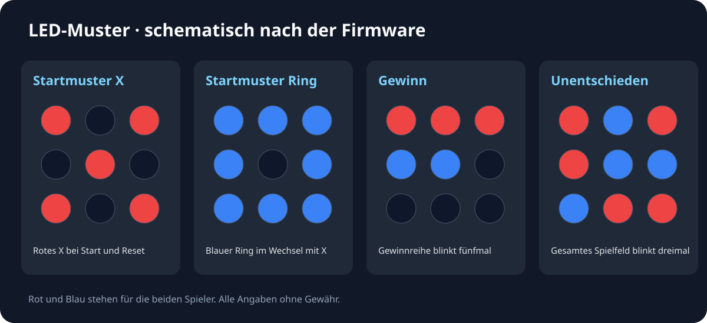

# Arduino-Tic-Tac-Toe – Aufbau und LED-Muster

Die Grafiken veranschaulichen die in der Firmware festgelegte Pinzuordnung und die enthaltenen Anzeigemuster.

## Aufbau

Taster, Spielklasse und LEDs sind logisch zugeordnet. Die Statusanzeige hat eine eigene Datenleitung.

## Spielzustände

Start und Reset wechseln zwischen rotem X und blauem Ring. Eine Gewinnreihe blinkt in der Spielerfarbe. Beim Unentschieden blinkt das gesamte Spielfeld.

## Technik

[Projekt und Technik](PROJEKT.md) · [Zur Übersicht](../README.md). Alle Angaben und Downloads ohne Gewähr.
