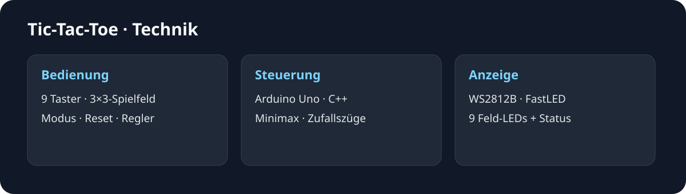
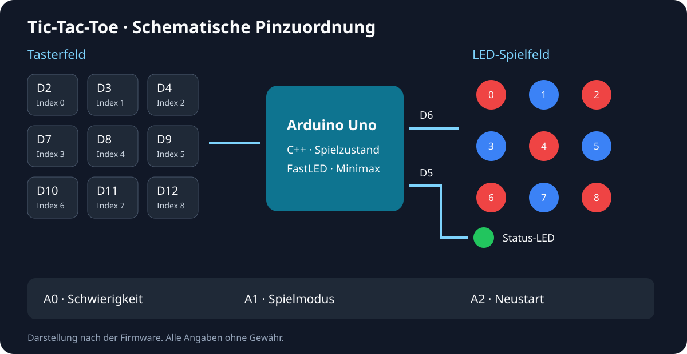

# Arduino-Tic-Tac-Toe – Projekt und Technik

## Idee

Das Projekt verbindet Spielelogik mit Hardware-Abstraktion, Eingabeereignissen und LED-Ausgaben. Der Sketch enthält überschaubare Aufgabenbereiche für Pinbelegung, Spielerwechsel, Tasterabfrage und Animationen. Die Klasse `TicTacToe` verwaltet den Spielablauf und den Computergegner.

## Dateien

| Datei | Aufgabe |
| --- | --- |
| `tic_tac_toe_solution_v1.ino` | Arduino-Start, Pinzuordnung, FastLED und Animationsfunktionen |
| `TicTacToe.h` | Schnittstellen, Zustände und Callbacks der Spielklasse |
| `TicTacToe.cpp` | Spiellogik, Eingaben, Computergegner und Demomodus |

## Pinbelegung

| Bauteil | Pin | Funktion |
| --- | --- | --- |
| Obere Tasterreihe | D2, D3, D4 | Spielfeldindizes 0, 1, 2 |
| Mittlere Tasterreihe | D7, D8, D9 | Spielfeldindizes 3, 4, 5 |
| Untere Tasterreihe | D10, D11, D12 | Spielfeldindizes 6, 7, 8 |
| Neun WS2812B-LEDs | D6 | Spielfeld |
| Einzelne WS2812B-LED | D5 | Statusanzeige |
| Potentiometer | A0 | Fehlerwahrscheinlichkeit des Computers |
| Modusschalter | A1 | LOW: Computer, HIGH: zwei Spieler |
| Reset-Taster | A2 | Neue Runde, aktiv bei LOW |

## Spielablauf

Spieler werden durch Rot und Blau dargestellt. Die Tasterabfrage erkennt den Wechsel von HIGH nach LOW. Die Spielklasse prüft Züge, Gewinnlinien und Unentschieden. Über Callbacks ruft sie die im Sketch enthaltenen Anzeige- und Animationsfunktionen auf.

Das Potentiometer wird von 0 bis 1023 eingelesen und auf eine Fehlerwahrscheinlichkeit von 0 bis 100 abgebildet. Der Computergegner verwendet eine rekursive Minimax-Bewertung mit Alpha-Beta-Beschneidung. Ein künstlicher Abstand von einer Sekunde macht Computerzüge im Spielablauf erkennbar.

## Anzeigen und Animationen

| Zustand | Darstellung |
| --- | --- |
| Start und Reset | Rotes X und blauer Ring, danach schrittweise Schachbrettfüllung |
| Computer-Modus | Grüne Status-LED |
| Zwei-Spieler-Modus | Gelbe Status-LED |
| Gewinn | Gewinnreihe blinkt fünfmal in der Spielerfarbe |
| Unentschieden | Spielfeld blinkt dreimal und wird geleert |
| Demo | Status-LED zeigt den aktiven Spieler in Rot oder Blau |

Nach 60 Sekunden ohne Tastendruck beginnt die Demo. In der voreingestellten Variante spielen zwei Computer gegeneinander. Zwischen Demozügen liegen zwei Sekunden. Ein Tastendruck beendet den Leerlaufmodus.

## Aufbau und Start

Benötigt werden ein Arduino Uno, neun Spielfeldtaster, ein Reset-Taster, ein Modusschalter, ein Potentiometer sowie neun Spielfeld-LEDs und eine Status-LED vom Typ WS2812B.

Die drei Quelldateien gehören gemeinsam in einen Sketch-Ordner namens `tic_tac_toe_solution_v1`. In der Arduino IDE die Bibliothek FastLED hinzufügen, das Board Arduino Uno und den passenden Anschluss wählen. Anschließend den Sketch prüfen und auf das eigene Board übertragen.

Die Firmware verwendet die Farbfolge GRB und eine Helligkeit von 150. Taster und Bedienelemente müssen entsprechend der Pinbelegung angeschlossen sein.

## English quickstart

The project targets an Arduino Uno with nine WS2812B board LEDs and one status LED. Keep the `.ino`, `.cpp` and `.h` files together in the sketch directory. Install FastLED in the Arduino IDE, select the Uno and the connected port, then verify and upload the sketch. A1 selects computer mode at LOW and two-player mode at HIGH. A0 controls the computer error rate. A2 resets the game.

[Zur Übersicht](../README.md) · [LED-Muster](GALERIE.md). Alle Angaben und Downloads ohne Gewähr.
